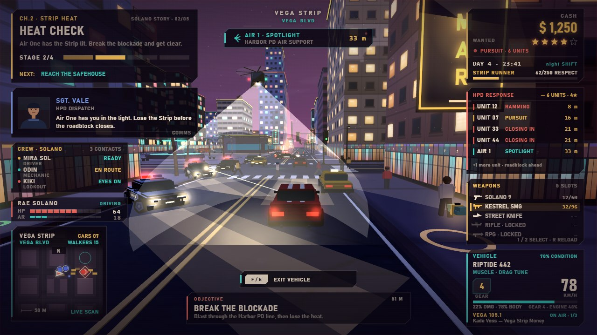
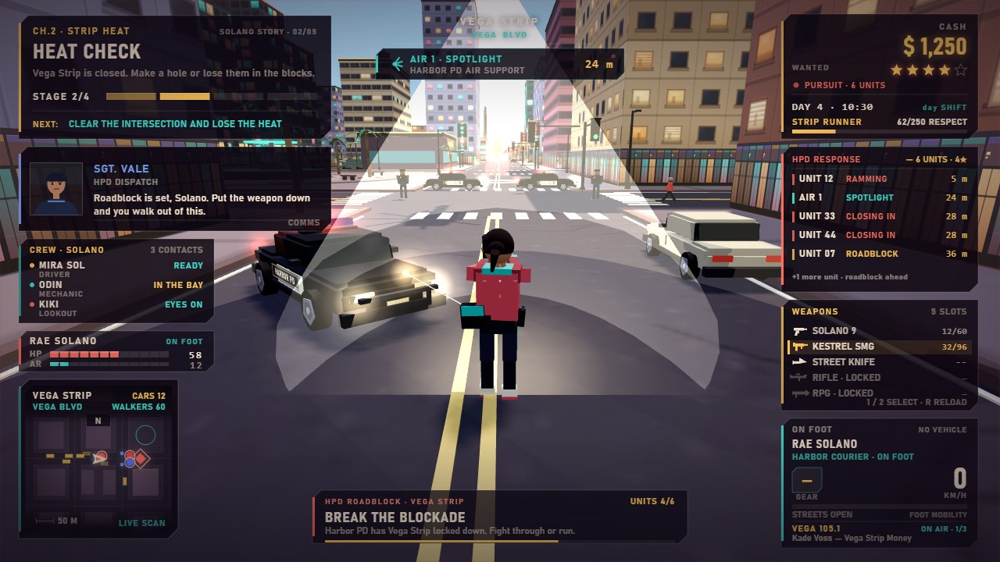

# Neon Harbor

[](https://make.fun/bounty/gta6-01?utm_source=github&utm_medium=readme&utm_campaign=gta6-01)
[](https://make.fun/bounty/gta6-01/leaderboard?utm_source=github&utm_medium=readme&utm_campaign=gta6-01)
[](https://make.fun/bounty/gta6-01?utm_source=github&utm_medium=readme&utm_campaign=gta6-01)



**An original third-person open-world crime game for the desktop browser —
one seeded harbor, five story missions, a full day/night cycle and a radio
that actually plays.**

Neon Harbor runs from [plain static files](docs/guide/building.md): no build
step, no package install, no third-party network request after the page loads.
You play courier **Rae Solano**, back in the harbor to settle a family debt.
The city is nine by nine blocks of storefronts, towers, brick market lanes,
rail yards, a beach, a pier, a working lighthouse and the enterable **Solano
Mall**. Read [the story](docs/guide/story.md) and
[the city](docs/guide/city.md) for the full picture.

## Overview


A real recording captured frame by frame from the live page: **New Game** on
Vega Strip, the walk down the boulevard past the palms and the traffic, and
Mira Sol's first call coming in over the radio. The HUD, minimap and radio
card are the ones you play with; nothing is composited.
`node tools/capture-media.mjs` re-records the GIF and the combat still — see
[building](docs/guide/building.md#animated-media).

## Play

Node 22.18 or newer serves the folder; the game is HTML, CSS, ES modules and a
WebGL canvas. There is [no build step](docs/guide/building.md) and no
third-party network use: the radio OGG files load from `game/audio/radio/` on
the same server.

```bash
node serve.ts --port 8080
# open http://localhost:8080
```

Click the view to capture the mouse. If the browser refuses pointer lock, the
same mouse drag looks around. **Enter** confirms the focused menu action.
Full controls and settings are in [HUD and audio](docs/guide/hud-audio.md);
driving detail is in [driving](docs/guide/driving.md).

| Action | Keys |
| --- | --- |
| Move / sprint / jump | **WASD** or arrows · **Shift** · **Space** |
| Enter or leave a car | **F** always; **E** when no context action is near |
| Context action | **E** — sit, stand, steal a parked car, rob the register, valet, retrieve |
| Drive | **W/S** throttle and brake/reverse · **A/D** steer · **Space** handbrake |
| Fire / aim | **LMB** / **RMB** |
| Weapons | **1** pistol · **2** SMG · **3** knife · **R** reload |
| Look / camera | **Mouse** · **wheel** |
| Radio | **T** on/off · **`[` `]`** station · **`,` `.`** track · hold **Tab** wheel |
| Volume / mute | **M** · **`-`** and **`=`** |
| Horn | **LMB** or **H** |
| Sit / stand | **E** sits on a chair, bench or lounger · **E** or **Space** stands |
| Missions | walk into a coral marker · **Enter** retry |
| Pause / save | **Esc** or **P** |

## What's inside

- **A five-mission chapter** — The Riptide Job, Heat Check, Special Delivery,
  Family Cut and Pier 9 Burning, with dialogue, combat crew, bosses, timers,
  failure and retry, plus free-roam stashes, chop-shop deliveries, the Heat
  Run and a safehouse. [Story and free roam →](docs/guide/story.md)
- **A living city** — 81 seeded blocks, Old Town's market square and the
  Foundry's rail yards, 100 signalised intersections, a 168-pedestrian crowd,
  18 traffic cars and a 9.6-minute day across dawn, day, dusk and night.
  [City and clock →](docs/guide/city.md)
- **The Solano Mall district** — an enterable 32 × 16 m mall with six shops,
  a six-table food court, 24 sittable chairs, a jewelry register to rob, and a
  26-stall parking lot with clock-driven occupancy, parked-car theft, valets
  and a two-guard security response. [Mall and lot →](docs/guide/city.md#solano-mall-and-the-lot)
- **Seven cars and carjacking** — arcade handling, drifting, skid marks,
  lane-following traffic, a driver who bails out at the door when you steal a
  civilian car, and the mall lot's valet service.
  [Driving and traffic →](docs/guide/driving.md)
- **Combat with consequence** — pistol, SMG and the always-carried street
  knife with its arm stab, vehicle hits and knockdowns, five-star police,
  Air 1, witness-driven murder heat, armed bystanders, panicking crowds and
  one loot drop per human death. [Combat, heat and loot →](docs/guide/combat.md)
- **Six stations, eighteen tracks** — original Suno-generated music, a
  crossfading two-deck player, a hold-Tab station wheel, SYNTH fallbacks and
  OFF AIR. [Radio →](docs/guide/radio.md) · [Music credits](MUSIC.md)
- **HUD and sound** — mission card, minimap, crew panel, dialogue, response
  roster, five-slot weapon strip, speed/condition card, radio line, WebAudio
  engine, sirens and guns, plus the Audio row in the title and pause menus.
  [HUD, audio and settings →](docs/guide/hud-audio.md)
- **Dependency-free builds and tests** — four screenshots, an overview GIF, a
  bounty dossier and 341 end-to-end checks.
  [Building](docs/guide/building.md) · [Testing](docs/guide/testing.md)

## Screenshots

Four real Chrome renders at **1280×720 JPEG**, each under 256 KiB. The first
by name is the cover; nothing is composited and no filters are applied.
`node tools/capture.mjs` regenerates them — see
[building](docs/guide/building.md#screenshots).

| | |
| --- | --- |
| [](screenshots/1-cover.jpg)<br>**1-cover.jpg · Night chase** — Air 1, two cruisers and the full HUD | [](screenshots/2-street.jpg)<br>**2-street.jpg · Daylight roadblock** — the living clock at 10:30 |
| [](screenshots/3-mission.jpg)<br>**3-mission.jpg · Solano Mall** — the food court, seated shoppers and the 18:00 clock | [](screenshots/4-title.jpg)<br>**4-title.jpg · Title** — the night skyline and the Audio row |

The combat still shows a staged pedestrian death and its loot drop:
[`docs/media/combat.jpg`](docs/media/combat.jpg). The Pier 9 heist moved off
the contact sheet to [`docs/media/heist.jpg`](docs/media/heist.jpg). Shot
staging and the media tools are described in
[building](docs/guide/building.md).

## Documentation

| Guide | What it covers |
| --- | --- |
| [Story and free roam](docs/guide/story.md) | the five missions, failure and retry, free-roam jobs, saving |
| [The city and the clock](docs/guide/city.md) | the seeded grid, districts, the mall and its lot, day/night palette, beach |
| [Driving, traffic and carjacking](docs/guide/driving.md) | the seven classes, handling, traffic AI, carjacking, parked cars and valet |
| [Combat, heat and consequences](docs/guide/combat.md) | weapons, knife arm, vehicle hits, police, Air 1, murder heat, loot |
| [The radio](docs/guide/radio.md) | stations, tracks, controls, wheel, fallbacks, persistence |
| [HUD, audio and settings](docs/guide/hud-audio.md) | every HUD card, audio layers, volume/mute, quality |
| [Serving, capture and the entry build](docs/guide/building.md) | serve, screenshots, GIF, `main.ts`, caps |
| [Testing and verification](docs/guide/testing.md) | loot, radio, 341 E2E checks, media checks |
| [Source map](docs/guide/source-map.md) | every game, tool, test and docs path |
| [Music credits](MUSIC.md) | all eighteen tracks, artists, durations, licence note |

The design specs and implementation plans live in
[`docs/superpowers/specs/`](docs/superpowers/specs/) and
[`docs/superpowers/plans/`](docs/superpowers/plans/). Radio generation prompts
and lyrics are in [docs/audio/suno-radio-prompts.md](docs/audio/suno-radio-prompts.md).

## Build and verify

```bash
node --test test/loot.test.mjs      # 4 tests
node --test test/radio.test.mjs     # 5 tests
node tools/test-npc-loot.mjs        # 341 end-to-end checks
MAKEFUN_OUTPUT_DIR=out node main.ts --check
```

The last run passed all four checks: 4/4 loot tests, 5/5 radio tests, 341/341
E2E checks and `check PASS` for the entry caps. The exact commands, the
twenty-six E2E groups and the media dimensions are in
[testing](docs/guide/testing.md). Build and capture instructions are in
[building](docs/guide/building.md).

## Bounty and license

Built for [make.fun · Make GTA 6](https://make.fun/bounty/gta6-01). The city,
characters, names, art, audio and code are original to this project. No
Rockstar assets, names, music, levels or art are used. The radio tracks were
generated with Suno; see the licence note in [MUSIC.md](MUSIC.md).

MIT, see [LICENSE](LICENSE).
