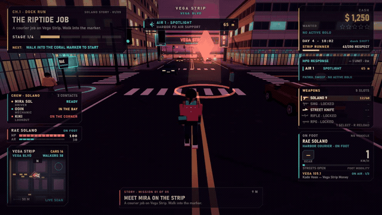
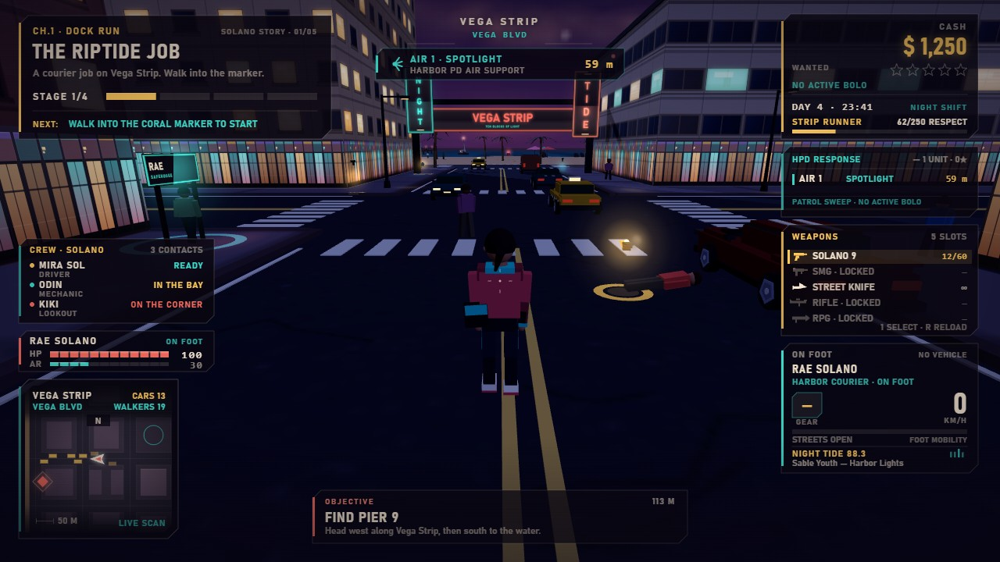
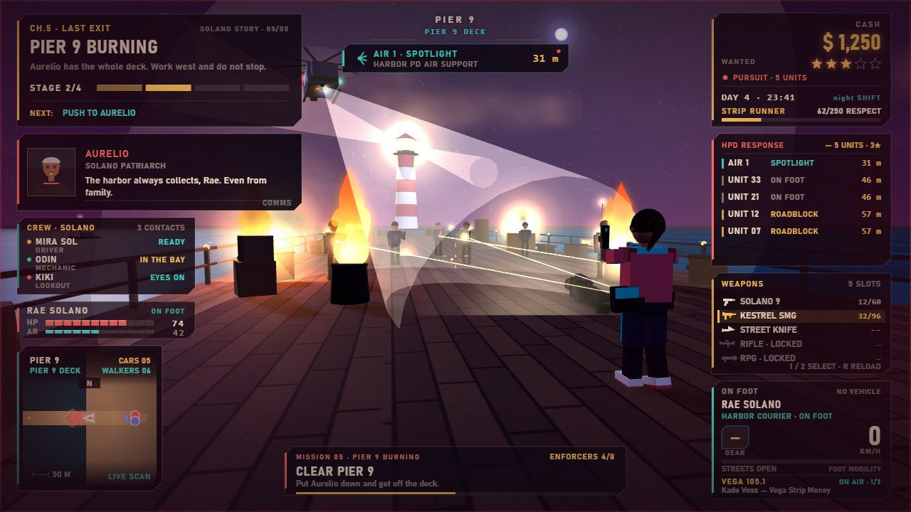
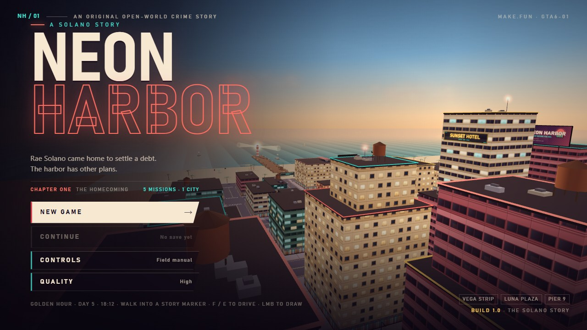

# Neon Harbor

[](https://make.fun/bounty/gta6-01?utm_source=github&utm_medium=readme&utm_campaign=gta6-01)
[](https://make.fun/bounty/gta6-01/leaderboard?utm_source=github&utm_medium=readme&utm_campaign=gta6-01)
[](https://make.fun/bounty/gta6-01?utm_source=github&utm_medium=readme&utm_campaign=gta6-01)


Neon Harbor is an original third-person open-world crime game for the desktop
browser. It runs from plain static files with no build step, no package
install and no network request after the page loads. The setting is a coastal
city with a living clock: nine by nine blocks of low-rise storefronts and
downtown towers, the brick market lanes of Old Town, the rail yards and
smokestacks of the Foundry, a wide beach, a long pier, a working lighthouse,
palms, streetlights and hand-built neon, from dawn through noon to a deep
indigo night.

You play courier **Rae Solano**, back in the harbor to settle a family debt.
The build is the whole first chapter: a seeded city, a third-person camera
that stays out of walls, seven drivable vehicle classes, grid traffic and
pedestrians, a five-star police response, two hitscan weapons, five story
missions with dialogue and combat, free-roam jobs, three synthesised radio
stations, a canvas HUD and a local save.

Pedestrians are shootable: they fall where they die, the crowd around them
panics, and every human NPC death — pedestrian, mission enemy or police
officer — leaves cash or ammunition on the pavement.

## Overview



A real recording, captured frame by frame from the live page: **New Game** on
Vega Strip, the walk down the boulevard past the palms and the traffic, and
Mira Sol's first call coming in over the radio. The HUD, the minimap and the
radio line are the ones you play with; nothing is staged for the camera beyond
hiding the pointer-lock prompt.

`node tools/capture-media.mjs` re-records this GIF and the combat still below
in one run — the same dependency-free Chrome DevTools driver the screenshots
use. The tool presses **Enter**, holds **W** for the walk and writes the
frames; ffmpeg (on `PATH`, or set `FFMPEG`) encodes the GIF. No npm packages,
no video files.

## Play

Node 22.18 or newer serves the folder; the game itself is HTML, CSS, ES
modules and a WebGL canvas. There is no build step and no network use.

```bash
node serve.ts --port 8080
# open http://localhost:8080
```

Click the view to capture the mouse. If the browser refuses pointer lock, the
same mouse drag looks around. **Enter** confirms the focused menu action.

- **WASD** or the arrow keys walk; **Shift** sprints; **Space** jumps.
- **F** or **E** enters the nearest slow car or leaves the car you are in.
- While driving, **W/S** is throttle and brake/reverse, **A/D** steers, and
  **Space** is the handbrake. Hold it through a corner to drift; the rear
  tires leave skid marks. **Left click** or **H** sounds the horn.
- On foot, **left click** fires or, with the knife out, stabs; **right click**
  aims and tightens the camera. **R** reloads, **1** selects the Solano 9
  pistol, **2** the Kestrel SMG once it has been picked up, and **3** the
  street knife.
- **Mouse** looks around; the **wheel** pulls the foot camera in or out.
- **T** switches the radio on or off, **`[`** and **`]`** change stations, and
  **M** mutes. **`-`** and **`=`** trim the master volume.
- Walk into a coral story marker to start the next mission. **Enter** retries
  a failed mission, and walking back into its marker does the same.
- The **safehouse** on the Vega Strip heals, recharges armor, clears heat and
  writes the save when you walk into its teal ring.
- Between jobs: walk over a gold cash stash, take a marked car to the Motor
  Row chop shop for a delivery fee, or step into the red **Heat Run** ring and
  hold three stars for forty-two seconds.
- **Esc** or **P** pauses and saves. The title screen's **Quality** switch
  moves between high (shadows, full pixel ratio) and low (no shadows, lighter
  pixel ratio) without a reload.

**New Game** starts on Vega Strip at 18:00 on day four, in the last light,
beside a parked Riptide and facing the water. **Continue** returns to the last
pause or save, including the story index, cash, health, armor, weapons, ammo,
position, the time of day and any heat that was still on you.

## The Solano story

Five missions run in order. Each has a start marker, a world objective, a
dialogue script, a completion condition and a cash reward; finishing one sets
the marker for the next.

1. **The Riptide Job** — Mira sends Rae to steal a Vela GT from the Sunset
   Hotel and deliver it to the Motor Row bay. ($1,200)
2. **Heat Check** — the car had a tracker. Lose the Harbor PD and reach the
   safehouse clean. ($1,800)
3. **Special Delivery** — carry the Solano ledger from Casa Luna to Tomas at
   Luna Plaza before the timer runs out. ($1,500)
4. **Family Cut** — Tomas' crew springs an ambush at the fountain. Fight out
   of the plaza and learn where Aurelio is waiting. ($2,400)
5. **Pier 9 Burning** — clear Aurelio's enforcers from the pier, set the place
   on fire and escape before the deck goes up. ($6,000)

Combat missions put real low-poly crew on the street with chest and head hit
boxes, line-of-sight checks, advancing and firing AI, death poses and a boss
health pool. The player's hitscan queries mission enemies as well as cruisers,
officers and cars. Each combat mission supplies an SMG and armor so a new
player is never sent in with an empty pistol. Finishing the fifth mission
paints **THE HARBOR IS YOURS** and leaves free roam open.

Failure is a state, not a reload. A downed or busted player, a missed delivery
window or a wrecked mission car sets the failure panel, returns the objective
marker to the mission start and offers **Enter** or a walk back into the
marker. Retrying resets the mission, heals Rae, clears the heat and rebuilds
the setup. The active mission index is written in the save, so Continue
re-offers the job from its start marker.

Free roam is always live around the story: six gold cash stashes respawn, a
marked Vela GT / Riptide / Dune Hauler appears in rotation for the chop-shop
delivery loop, and the Heat Run marker starts a timed three-star holdout. The
safehouse at `(-71.5, 36.6)` is the save point. Every completed mission, cash
pickup, delivery, heat run and safehouse visit writes progress through
`save.js`. Settings (quality, volume, mute) live in their own key; the save
carries cash, health, armor, wanted stars, mission index, story-complete flag,
weapons, ammo, camera yaw, position, the minute of day and the day number.

## The city

The whole harbor is built from one seed in `game/src/config.js`, so every
tower, window layout and sign lands in the same place on every load. Roads
form a ten-line grid — nine blocks each way — with lane paint, crossings and
raised sidewalks. The original six-by-six core keeps its exact towers,
storefronts and signs; the extension grows two districts around it. **Old
Town** to the north is low brick with striped awnings, chimneys and an open
market square of eight stalls, a bandstand and a pylon sign. **The Foundry**
to the east is a yard district of wide shallow warehouses, steel rails and
brick smokestacks with red aircraft lights. Buildings use eight facade
palettes with punched, ribbon and glass window patterns, floor bands, lit
rooms with blinds and curtains, rooftop tanks and antennas, emissive
storefronts and neon boards. Landmarks include the Sunset Hotel tower, Casa
Luna on the beach, Motor Row, the Luna Plaza fountain, the radio mast, the
Vega Strip arch, Pier 9 and its lighthouse.

## Times of day

`environment.js` owns one clock and the palette it drives. A New Game starts
at **18:00 on day four**; the clock runs one in-game minute per two real
seconds, so a full day takes 48 real minutes and the HUD's `DAY n · HH:MM`
line advances through it. Continue restores the saved minute and day.

| Period | Clock | What the palette does |
| --- | --- | --- |
| Dawn | 05:00–07:00 | rose fog, a low amber sun, windows and lamps half on |
| Day | 07:00–17:00 | pale blue sky, a high white sun, windows and neon dimmed, no lamp pools or headlight beams |
| Dusk | 17:00–19:00 | orange horizon, long shadows, windows and signs coming up |
| Night | 19:00–05:00 | the indigo-to-magenta sky, the moon and stars, full neon, lamp pools and headlights |

Each boundary gets a sixty-minute smoothstep blend. The palette is one blend
of fog colour and distance, hemisphere and ambient light, sun direction and
warmth, exposure, sky texture crossfade, star opacity, moon and sun sprites,
window emission, crown and pier neon, street-lamp colour and pools, car
headlight brightness, and water tint and sparkle. The night keeps the moon,
the magenta band of city light pollution on the horizon, cool moonlight plus
warm emissive windows, instanced pools under the streetlights and blade signs,
the scrolling water, the turning lighthouse beam and drifting clouds.

A `?shot=` capture pins the clock at **23:41** so the screenshots are
repeatable; `?time=HH:MM` overrides it for any shot or free-play load. The day
screenshot in this README is the same blockade pose captured with
`?time=10:30`.

A typical 1280×720 frame in this build uses about **370 draw calls** at the
chase shot, with a **6.1 ms** median frame over a 60-frame sample in headless
Chrome on the build machine; the pre-living-city base measures 433 and 6.7 ms
on the same harness. Static glows share one instanced billboard field, each car's four
wheels are one instanced mesh, and the Air 1 airframe is merged per material,
so the larger city and crowd cost less per frame than the old six-by-six
build.

## Traffic and driving

`vehicles.js` builds seven original classes from merged low-poly parts: the
**Fathom 400** sedan, **Harbor Cab**, **Vela GT** sports car, **Riptide 442**
muscle car, **Mule 9** van, **Dune Hauler** pickup and **Harbor PD Cruiser**.
Each has its own proportions, paint palette, wheels, headlights, taillights,
glass and handling; the cruiser adds a white-door livery, a door decal and a
red/blue light bar. Bodies, trim, glass and lamps share geometries, so a car
stays around nine draw calls. Handling is arcade: throttle and reverse,
speed-sensitive steering, lateral grip that lets the rear step out under the
handbrake, ground-following pitch and roll on curbs and the pier ramp,
building collision, and a pooled skid-mark ribbon. Engine state is exposed per
vehicle for audio.

`traffic.js` keeps up to **18 cars** in the grid lanes and fills the blocks
with **96 pedestrians**: a 48-walker sidewalk crowd that loops the block
edges, 22 people on the beach and the pier, and crosswalk pedestrians. Cars
brake for the stop line, keep a following gap to anything in their lane, wait
for pedestrians in the crosswalk, and recycle in and out of view around the
player. The whole crowd is drawn through instanced meshes, so the street stays
fluid with a full crowd on screen.

Every one of the 100 intersections has a visible signal (`traffic-signals.js`):
a pole and two heads, one colour-and-axis instanced lamp set each, and a small
night pool. The lamps and the car rule call the same `signalState()` — green
for 7.5 s, amber for 1.5 s, red for the other axis — so a driving light and a
stopping car cannot disagree. The minimap mirrors the traffic with vehicle
blips and the HUD reports the live car and walker counts.

Pedestrians never walk through a building. `world.resolveCircle()` pushes the
walker out of the nearest collider and `walkToward()` tries the full step,
then x-only, then z-only, then stops and lets the block loop pick another
corner. Foot officers and mission enemies use the same resolve, so a chase
around a corner slides along the wall instead of clipping through it.

## Heat and combat

`police.js` runs the five-star director. A cruiser spawns on a road node out of
view and follows the road grid toward the player with a small breadth-first
route, then switches to a direct pursuit, rams at speed and fires from the
window once the heat reaches three stars. At three stars cruisers also stop and
put officers on foot, and at four a two-car roadblock with waiting officers can
appear ahead of a moving car. Every officer and cruiser is a real target: shots
land on heads, bodies and bodywork, cruisers have health and explode when
destroyed, and the minimap draws their blips. When the player is out of sight
for a few seconds the department switches to a search around the last known
position; after a longer wait the stars fall one at a time and the units stand
down. Stopped on foot, close to an officer, with no weapon raised and no recent
shot, the bust timer runs. The flow hands control back to `main.js`, which
paints the wasted/busted overlay, takes a cut of the cash and respawns Rae.

The same director owns **Air 1**, an HPD helicopter that patrols above the
streets with a spinning main rotor, a tail rotor, navigation lights and a
visible searchlight cone. It sweeps the pavement on a quiet night and locks the
beam onto Rae's car once a pursuit starts; its horizontal range feeds the
top-centre `AIR 1 · SPOTLIGHT` banner and the response roster. Each cruiser,
officer and the air unit gets a callsign and a live role — RAMMING, PURSUIT,
CLOSING IN, ROADBLOCK or SPOTLIGHT — plus its distance in metres.

Combat lives on `player.js`: the pistol and SMG are hitscan with spread,
recoil, muzzle flash, tracer, impact sparks, a hit marker, magazine and reserve
ammo and a reload timer. Bullets stop on the nearest collider, vehicle or
officer, so cover works. Armor absorbs part of each hit before health; damage
shakes the camera and reddens the screen edge. The **street knife** on slot 3
is always carried: left click swings it 2.1 m from Rae's chest along the
camera's direction for 60 damage with no headshot bonus, no ammunition and no
gunshot, so it never reports gunfire. A hit plays the blade whoosh and impact
sparks; a miss is silent. `pickups.js` places both guns plus medkits and armor
on chrome rings around the map; they float, glow, respawn and announce
themselves in a toast.

Pedestrians are targets too. Every walker carries a chest sphere and a head
sphere, 55 health and the same ×1.75 headshot multiplier as the officers: a
34-damage pistol round drops one in two body hits or a single clean headshot.
The body folds into an instanced fall, lies on the pavement for about eight
seconds and then goes; anyone within fourteen metres panics, sprints off for
six seconds and then walks back to their route.

Murder now raises heat. A civilian kill seen by an officer within 70 m, a
cruiser within 90 m of Rae or Air 1 within 90 m of the body adds one wanted
star immediately; with no police in sight, a witness queues a 911 call that
arrives three seconds later as `WITNESS CALLED 911`. A kill in an empty street
stays quiet, an officer's death still costs two stars and a mission enemy's
death adds no civilian heat. Fifteen percent of the block-loop walkers wear a
dark red jacket and carry a pistol: a murder within the fourteen-metre panic
radius makes them draw for 0.9 s and then fire every 1.2 s for nine damage
while Rae is within 30 m and in sight, with a muzzle flash, tracer and pistol
audio. They give up after twelve seconds or once Rae is past 45 m, and the
first one to turn raises the `ARMED WITNESS · RETURN FIRE` toast. They remain
ordinary crowd targets and drop the usual loot.

Every human NPC death leaves exactly one item: 60% cash, 30% Solano 9 ammo
(+12) and, once the Kestrel SMG is owned, 10% an SMG crate (+32); before the
unlock that share folds back into pistol ammo. Pedestrian and officer cash
pays $15–70 in $5 steps, mission enemies pay $40–120 and the boss pays a flat
$150 when it drops cash. The drop lands on a small glowing ring, pays out when
Rae walks over it, announces itself in a toast, and expires after 30 seconds;
a collected or expired drop never respawns.



A staged pedestrian kill at `?shot=street`: the body folds into the fall and
the glowing ring beside it is the drop, ready for Rae to walk over.

## Effects, HUD and audio

`effects.js` owns fixed-size pools for sparks, smoke, flash sprites and tracers,
a reusable explosion light, the skid-mark ribbon, headlight beams and taillight
halos, and camera shake. The hurt level it accumulates feeds the HUD vignette.
Nothing in the effect layer allocates a mesh at the moment of a shot or an
explosion.

`hud.js` is a Canvas 2D layer over the WebGL view. The left rail carries a
chapter card (`CH.2 · STRIP HEAT`, the mission title, a one-line objective, a
four-segment `STAGE 2/4` bar and a `NEXT:` line), Rae's health and armour bars
with hit flashes, the baked minimap with the district, named street, traffic
and walker counts, the player arrow, alternating red/blue police and officer
blips, mission enemies in coral and the objective marker, plus the crew panel
(Mira Sol, Odin and Kiki with live role/status lines) and an NPC dialogue box
with a drawn portrait, speaker name, role and line. The right rail carries the
cash card, five wanted stars, `PURSUIT · 6 UNITS` or the search status, the
`DAY 4 · 18:00` clock with a live `DAWN / DAY / DUSK / NIGHT SHIFT` label,
the `STRIP RUNNER · 62/250 RESPECT` meter, the HPD
response roster with named callsigns, roles and distances, the five-slot weapon
strip (Solano 9, Kestrel SMG, the always-carried street knife at slot 3 with
`--` ammo and a `STREET KNIFE · CQC` footer, and locked rifle and RPG slots),
and the vehicle card with model, class, tune, a large speed readout, condition
and damage percentages, gear, engine load and the Night Tide 88.3 radio line. A
top-centre `AIR 1 · SPOTLIGHT` banner tracks the helicopter's range; the bottom
centre keeps the live objective, progress or countdown, the context prompt, a
dynamic crosshair (a fixed small reticle for the knife) and hit marker. Street
jobs get their own progress panel under the location line; rewards and mission
results arrive as toasts and a gold cash banner. Getting wasted or busted takes over the screen with a
full-frame overlay, drops part of the cash on hand and returns Rae to the strip
with the heat cleared; a failed mission stays on screen with a retry prompt
until you take it again.

`audio.js` builds the whole soundscape with WebAudio oscillators and noise: an
engine hum tracking rpm, load and speed, a two-tone siren whose level follows
the nearest cruiser or officer, pistol and SMG reports, impacts, explosions,
the horn, reload clicks, pickup chimes, hurt and wasted/busted stings, and menu
blips. Three original station loops — synthwave, chiptune and surf — are
sequenced live from the same oscillator kit: Night Tide 88.3 (Sable Youth —
“Harbor Lights”), KNRV 104.7 and The Breakwater 97.1. The context is created on the first real pointer or
keyboard gesture; no audio files and no network requests are involved. Volume
and mute persist with the quality setting.

## Screenshots

`screenshots/` holds exactly four real Chrome renders at **1280×720 JPEG**,
each under 256 KiB. The first by name is the cover. They are captured by
`tools/capture.mjs` from the live page with headless Chrome; nothing is
composited and no filters are applied.

| | |
| --- | --- |
| <br>**1-cover.jpg · Night chase** | <br>**2-street.jpg · Daylight roadblock** |
| <br>**3-mission.jpg · Pier 9 burning** | <br>**4-title.jpg · Title** |

What each shot shows:

- `1-cover.jpg` — `?shot=chase`: the night chase on Vega Strip with the red
  Riptide, two HPD cruisers with lit bars, lane traffic, crosswalk pedestrians,
  the MART neon, Air 1 and its searchlight overhead, and the full HUD at once:
  CH.2 mission card, six-unit response roster, Sgt. Vale dispatch dialogue,
  crew panel, five-slot weapon strip and the Riptide vehicle card at 78 km/h.
- `2-street.jpg` — `?shot=blockade&time=10:30`: the same roadblock in
  daylight, proving the living clock: pale blue sky, a high sun, long building
  shadows, dimmed windows and neon, and the four-star roster with RAMMING,
  SPOTLIGHT, CLOSING IN and ROADBLOCK entries. The HUD reads
  `DAY 4 · 10:30 · DAY SHIFT`.
- `3-mission.jpg` — `?shot=heist`: the Pier 9 docks at night, the lighthouse,
  burning barrels, Aurelio's enforcers and tracers, the CH.5 · LAST EXIT /
  PIER 9 BURNING card, the `CLEAR PIER 9` objective and the Pier 9 minimap.
- `4-title.jpg` — `?shot=start`: the title and menu over the live night
  skyline, Sunset Hotel, the pier and the full extent of the city.

Every shot builds the real world, player, police or mission director, weapons,
effects and HUD, runs a fixed number of simulation steps and then freezes. Shot
mode forces high quality, suppresses toasts and the fresh-slot title card, and
does not depend on pointer lock or the wall clock. `tools/capture.mjs` pins the
cover, heist and title to the shot clock (23:41) and the roadblock to
`?time=10:30`, so the four-image contact sheet shows both ends of the living
clock. The other staged poses (`street`, `drive`, `mission`, `pier`) remain
available for development checks.

## Build the entry

`main.ts` makes a clean copy of `game/` and `screenshots/` under
`MAKEFUN_OUTPUT_DIR` (or `/output`), writes `dossier.json` with
`vendor/makefun-game.ts`, and leaves the output ready to hand in. It uses only
the Node standard library and runs directly as TypeScript on Node 22.18+.

```bash
node tools/capture.mjs                 # four 1280×720 JPEGs in screenshots/
MAKEFUN_OUTPUT_DIR=out node main.ts
MAKEFUN_OUTPUT_DIR=out node main.ts --check
```

`tools/capture.mjs` is a stdlib-only Chrome DevTools driver: it serves `game/`,
launches headless Chrome with GPU WebGL, navigates each `?shot=` scene, waits
for the frozen frame, captures a JPEG at 1280×720 and retries at a lower JPEG
quality if the file would exceed 256 KiB. It checks the JPEG header dimensions
and fails on any console or page exception.

`--check` re-reads the copy against the bounty caps and prints one summary
line:

- game files and directories at most **993**;
- game bytes at most **48 MiB**;
- **3–4** screenshots, each at most **256 KiB**;
- dossier at most **1.5 MiB**, with the dossier text cut at **160 KiB**.

The dossier lists the game's source, then `game/index.html` and the module
import graph, then the remaining source in path order. The two minified
three.js builds and the one-line `three.module.js` shim are vendored files and
are listed by path and size rather than shown as source. There are no other
libraries, no generated bundles and no binary assets in `game/`.

## Testing

Two dependency-free checks cover the death and loot systems; run both from the
repository root:

```bash
node --test test/loot.test.mjs     # pure loot table
node tools/test-npc-loot.mjs       # headless Chrome end-to-end
```

`test/loot.test.mjs` pins the death-drop weights, the $5 cash steps and bounds,
and the SMG gate without a browser. `tools/test-npc-loot.mjs` serves `game/`,
launches headless Chrome through the DevTools protocol like
`tools/capture.mjs`, and drives the frozen `?shot=street` and `?shot=blockade`
scenes through `window.__neon`: the pedestrian chest hitbox, damage and death,
the fall state and corpse cleanup, the 14 m panic radius and 6 s flee and
recovery, loot pickup and its 30-second expiry, reset, the real
`player.fireWeapon` path and officer death loot, the murder-heat 911 delay and
its police-witness shortcut, the knife's slot-3 selection, 1.5 m lethal reach
and silent gunfire-free kill, the armed witness's draw, first shot and
45 m give-up, plus three groups added with the living city:

- **crowd density** — the 96/48/22/18 targets, all 22 beach walkers seeded, no
  two pedestrians sharing a slot, the 48-walker sidewalk fill, and a free slot
  still available after the fill;
- **traffic signals** — a signal at every one of the 100 intersections, the
  green/amber/red rule at seven times, and the visible lamp sets matching the
  state at green, amber and the switch;
- **pedestrian collision** — a target straight through a known building, the
  stop at the wall face, a reachable target still reached, forward progress
  along a wall, and 60 simulated seconds with no live walker inside a collider;
- **living clock** — the 81 blocks, the pinned 23:41 night, all four periods
  and their sky textures, the day/night palette levels, a fifteen-minute
  advance over thirty real seconds, the saved minute restored by Continue and
  the day rollover at midnight.

The suite prints one `ok`/`not ok` line per check and exits non-zero on a
failure; the last run passed all 140 checks.

```bash
node --test test/loot.test.mjs     # pure loot table
node tools/test-npc-loot.mjs       # headless Chrome end-to-end, 140 checks
MAKEFUN_OUTPUT_DIR=out node main.ts --check   # entry caps, one summary line
```

Set `CHROME` to a Chrome or Chromium executable if the default lookup misses.

## Source map

- `game/index.html` — page, title/pause/controls markup, CSS, boot-error
  reporter.
- `game/src/main.js` — boot, fixed-step loop, screen state machine, quality,
  save wiring, vehicle entry/exit, radio state and deterministic shot staging.
- `game/src/world.js` — nine-by-nine city generation, Old Town and the
  Foundry, the market square, ground/collision/camera queries, beach, pier,
  lighthouse, ocean, the four sky textures, sun and moon, lights, signs, the
  merged glow field and animation.
- `game/src/environment.js` — the 24-hour clock, the dawn/day/dusk/night
  palettes, the boundary blend, `?time=` parsing and the renderer/scene apply
  step.
- `game/src/glow-field.js` — one instanced camera-facing quad mesh for the
  static glow sprites (aircraft beacons, street lamps, pier bulbs, sign spill),
  with per-item colour and brightness.
- `game/src/geo.js` — reusable mesh, facade, sign and billboard factories, and
  the geometry merge.
- `game/src/vehicles.js` — seven vehicle classes, meshes, instanced wheels,
  arcade physics, lights and pooled skid marks.
- `game/src/traffic.js` — 18 lane cars, the 96-slot crowd, crosswalk crossings,
  beach/pier crowd, panic and armed witnesses, wall sliding, and shot staging.
- `game/src/traffic-signals.js` — the shared 18 s signal clock, the merged
  pole/housing mesh, the six instanced lamp sets and the night pool.
- `game/src/police.js` — wanted level, pursuit driving, search/decay, cruiser
  and officer combat, civilian murder reports and the 911 call, roadblocks,
  callsigns, the merged Air 1 airframe and its searchlight, the response
  roster, busted/wasted handshake and chase staging.
- `game/src/missions.js` — the five-mission director: markers, dialogue queue,
  mission enemies and bosses, objectives, timers, rewards, failure and retry,
  pier fire, and mission/heist staging.
- `game/src/activities.js` — cash stashes, the rotating hot-car delivery, the
  Heat Run, the safehouse save/heal/clear-heat point and their street panels.
- `game/src/loot.js` — the pure death-drop table: weights, $5 cash steps and
  the SMG unlock gate.
- `game/src/pickups.js` — walk-over pickup rings, weapon/medkit/armor spawns,
  one-shot death drops, 30-second expiry, payout and reset cleanup.
- `game/src/player.js`, `humanoid.js` — movement, driving, chase camera,
  vehicle collision, hitscan guns and the street knife, aiming, damage and
  Rae's low-poly walk/run/aim cycle.
- `game/src/effects.js` — sparks, smoke, flashes, tracers, explosions, skid
  marks, vehicle lights, screen shake and hurt accumulation.
- `game/src/audio.js` — the WebAudio engine, sirens, guns, impacts, horn, UI
  blips, stings and three live radio sequencers.
- `game/src/hud.js` — the Canvas 2D HUD: mission card, vitals, state card,
  minimap and blips, crew panel, portrait dialogue, police response roster,
  Air 1 banner, five-slot weapon strip, vehicle/radio card, objective and
  street-job panels, crosshair, rewards and failure/down/ending screens.
- `game/src/input.js` — keyboard, mouse, wheel, pointer lock and mouse edges.
- `game/src/save.js` — guarded localStorage save, story/mission index, weapons,
  clock minute and day, quality, volume and mute settings.
- `game/src/random.js`, `config.js` — seeded RNG, the city dimensions and road
  grid, the clock constants, district and street names, tune labels and shared
  constants.
- `game/src/shots.js` — the fixed `start`, `street`, `blockade`, `drive`,
  `chase`, `mission`, `heist` and `pier` screenshot poses, each pinnable to a
  different `?time=HH:MM`.
- `game/vendor/` — three.js r180's minified module and core builds behind the
  one-line `three.module.js` shim.
- `main.ts`, `serve.ts`, `vendor/makefun-game.ts` — entrypoint, development
  server and the bounty's dossier library.
- `tools/capture.mjs` — the stdlib-only headless-Chrome screenshot driver.
- `tools/capture-media.mjs` — the README media driver behind
  `docs/media/overview.gif` and `docs/media/combat.jpg`; needs ffmpeg on
  `PATH` or in `FFMPEG`.
- `tools/test-npc-loot.mjs` — the stdlib-only headless-Chrome E2E for
  pedestrian death, panic and loot, murder heat, the street knife, armed
  witnesses, crowd density, the intersection signals and pedestrian wall
  collision across the frozen street and blockade scenes.

## Bounty and license

Built for [make.fun · Make GTA 6](https://make.fun/bounty/gta6-01). The city,
characters, names, art, audio and code are original to this project. No
Rockstar assets, names, music, levels or art are used.

MIT, see [LICENSE](LICENSE).
