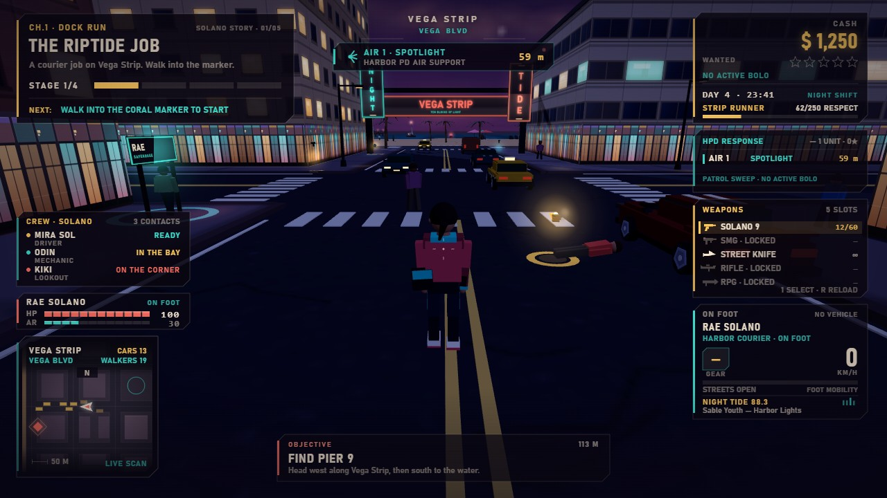

# Combat, heat and consequences

[← README](../../README.md) · [Story](story.md) · [Driving](driving.md) · [HUD and audio](hud-audio.md)

Combat is hitscan and readable: the crosshair decides, the muzzle flash and
tracer show the line, and walls, parked cars and cruisers stop a round. Every
human NPC is a real target with a chest and head hitbox, health, a fall and a
loot drop.

## Weapons

| Slot | Weapon | Damage | Rate | Magazine / reserve | Range | Notes |
| --- | --- | --- | --- | --- | --- | --- |
| 1 | **Solano 9** | 34 | 4.4/s | 12 / 60 | 88 m | semi-auto pistol, always owned |
| 2 | **Kestrel SMG** | 19 | 11.5/s | 32 / 96 | 72 m | automatic, unlocked by pickup |
| 3 | **Street Knife** | 60 | 1.8/s | — | 2.1 m | always carried, silent, no headshot bonus |

**Left click** fires or, with the knife out, stabs. **Right click** aims and
tightens the camera. **R** reloads, **1** selects the pistol, **2** the SMG
once it has been picked up, and **3** the knife. The pistol and SMG have
spread, recoil, muzzle flash, tracer, impact sparks and a hit marker. Armor
absorbs part of each hit before health; damage shakes the camera and reddens
the screen edge.

The knife is a real melee weapon, always on slot 3. A swing reaches 2.1 m
from Rae's chest along the camera direction for 60 damage, with no
ammunition, no tracer and no gunshot report, so it never calls the gunfire
heat path. A hit plays the blade whoosh and impact sparks; a miss is silent.
The right arm and hand drive the blade into a forward stab for the 0.28 s
swing (the shoulder rotates forward, the elbow extends, the torso twists and
the left arm counters), then the pose returns to the walk or aim cycle; the
blade itself keeps its own rotation as a secondary flourish.

`pickups.js` places both guns plus medkits and armor on chrome rings around
the map. They float, glow, respawn and announce themselves in a toast.

## Target layers

A shot queries the nearest hit in this order:

1. mission enemies (chest and head);
2. police officers (chest and head);
3. pedestrians (chest and head);
4. cruisers and vehicles;
5. world colliders.

Pedestrians use the same hitbox geometry as officers: a chest sphere of
radius 0.42 at `y + 1.12 × scale` and a head sphere of radius 0.22 at
`y + 1.55 × scale`. They have 55 health and the ×1.75 headshot multiplier, so
a 34-damage pistol round drops one in two body hits or one clean headshot.
Mission crew have chest and head hitboxes, line-of-sight checks, advancing and
firing AI, death poses and a boss health pool.

## Death, panic and loot

A dead pedestrian folds into an instanced fall, lies on the pavement for
about eight seconds and then goes. Anyone within **14 m** panics, sprints away
for **6 s** at 1.6× speed and then walks back to their route. A seated mall
shopper stands and frees the chair before running; a corpse never keeps a seat
reserved.

Every human NPC death leaves exactly one item:

| Outcome | Chance | Contents |
| --- | --- | --- |
| Cash | 60% | $15–70 in $5 steps (pedestrians and officers); $40–120 mission crew; $150 boss |
| Solano 9 ammo | 30% | +12 rounds |
| Kestrel SMG crate | 10% | +32 rounds, only after the SMG is owned |

Before the SMG unlock, the SMG share folds back into pistol ammo. The drop
lands on a small glowing ring, pays out when Rae walks over it, announces
itself in a toast, and expires after 30 seconds. A collected or expired drop
never respawns.

A staged pedestrian kill at `?shot=street`: the body folds into the fall and
the glowing ring beside it is the drop, ready for Rae to walk over.

## Vehicle hits and knockdown

Every moving car that overlaps Rae is a weapon. `Player.resolveVehicleContacts`
tests the car's oriented box against Rae's circle each on-foot update:

- any overlap always pushes her out of the bodywork;
- above about **2.5 m/s** the same contact lands one damage hit (8 + 0.8 ×
  speed, capped at 30) and a **0.9 s** knockdown;
- the hit sets a knockback velocity away from the car, throws her up, tilts
  the humanoid into a fallen pose and ignores movement and fire input until
  she stands;
- a shared **1.25 s** cooldown means one impact cannot double-hit, with a
  0.35 s post-hit grace after standing.

A police ram calls the same `hitByVehicle(car, 18)` path, so a cruiser and a
civilian car cannot disagree about what a collision does. A lethal ram still
raises the wasted overlay because the damage routes through the police
director.

## Police and Air 1

`police.js` runs the five-star director:

- A cruiser spawns on a road node out of view, follows the road grid toward
  the player with a small breadth-first route, then switches to a direct
  pursuit, rams at speed and fires from the window once the heat reaches
  three stars.
- At three stars cruisers also stop and put officers on foot; at four stars a
  two-car roadblock with waiting officers can appear ahead of a moving car.
- Every officer and cruiser is a real target: shots land on heads, bodies and
  bodywork, cruisers have health and explode when destroyed, and the minimap
  draws their blips.
- Out of sight for a few seconds, the department searches around the last
  known position; after a longer wait the stars fall one at a time and the
  units stand down.
- Stopped on foot, close to an officer, with no weapon raised and no recent
  shot, the bust timer runs.

The same director owns **Air 1**, an HPD helicopter that patrols above the
streets with a spinning main rotor, a tail rotor, navigation lights and a
visible searchlight cone. It sweeps the pavement on a quiet night and locks
the beam onto Rae's car once a pursuit starts. Its horizontal range feeds the
top-centre `AIR 1 · SPOTLIGHT` banner and the response roster. Each cruiser,
officer and the air unit gets a callsign and a live role — RAMMING, PURSUIT,
CLOSING IN, ROADBLOCK or SPOTLIGHT — plus its distance in metres.

## Murder heat

A civilian kill is a crime the city notices:

- **Police witness** — any live officer within 70 m of the body, any active
  cruiser within 90 m of the player, or Air 1 within 90 m of the body adds
  one wanted star immediately (`Civilian Killed`). If Rae is already wanted,
  the pursuit refreshes instead.
- **Civilian witness, no police** — a witness queues a 911 call that arrives
  three seconds later as `WITNESS CALLED 911` and adds one star if Rae is not
  already wanted.
- **No witness** — a kill in an empty street stays quiet.
- **Officer death** costs two stars (`Officer Down`).
- **Mission enemy death** adds no civilian heat; it is gang business.

**Armed witnesses** make a crowded street dangerous. Fifteen percent of the
block-loop walkers wear a dark red jacket and carry a pistol. A murder within
the 14 m panic radius makes them draw for 0.9 s and then fire every 1.2 s for
nine damage while Rae is within 30 m and in line of sight, with a muzzle
flash, tracer and pistol audio. They give up after twelve seconds or once Rae
is past 45 m, and the first one to turn raises the `ARMED WITNESS · RETURN
FIRE` toast. They remain ordinary crowd targets and drop the usual loot.

## The mall robbery

The jewelry counter on the mall's west wall has one robbery per city reset.
Standing within 2 m prompts **E · ROB**. Pressing it:

- starts the alarm sting and calls `police.addWanted(3, 'Mall Robbery')`;
- spawns two security guards inside the hall, in dark uniforms with hats;
- makes every shopper within 18 m panic and run for the doors;
- drops $650–950 in cash down the counter.

The guards are ordinary armed pedestrians with 78 health: killable, lootable,
and counted by the witness and heat systems. They spawn inside the mall, so
both always engage; police cruisers cannot enter the building because the
whole footprint is vehicle-blocked, but foot officers can come through the
3.2 m doors. The register is spent for the rest of the city reset; a second
**E** only shows the empty prompt.

## Wasted and busted

Getting wasted or busted takes over the screen with a full-frame overlay,
drops part of the cash on hand and returns Rae to the strip with the heat
cleared. A failed mission stays on screen with a retry prompt until you take
it again. Loot, corpses and drops reset with the scene.

## Where this lives

- `game/src/player.js` plus `player-combat.js` — hitscan guns, knife swing,
  vehicle contacts and knockdown, camera shake and damage.
- `game/src/humanoid.js` — the melee arm pose layered over walk and aim.
- `game/src/police.js` plus `police-units.js` and `police-air.js` — wanted
  level, pursuit, roadblocks, Air 1, murder reports, 911 and the
  wasted/busted handshake.
- `game/src/traffic.js` plus `traffic-peds.js` — pedestrian hitboxes, panic,
  armed witnesses, seating and death.
- `game/src/robbery.js` — the mall register, alarm, security guards and cash
  drop.
- `game/src/missions.js` plus `missions-actor.js` — mission crew hitboxes,
  bosses and mission deaths.
- `game/src/loot.js`, `game/src/pickups.js` — the drop table and the glowing
  walk-over rings.
- `game/src/effects.js` — sparks, tracers, explosions, shake and hurt.
